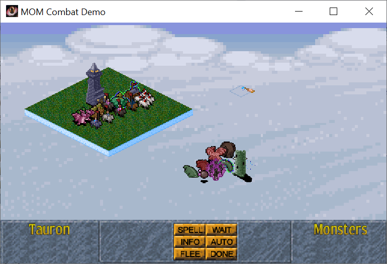
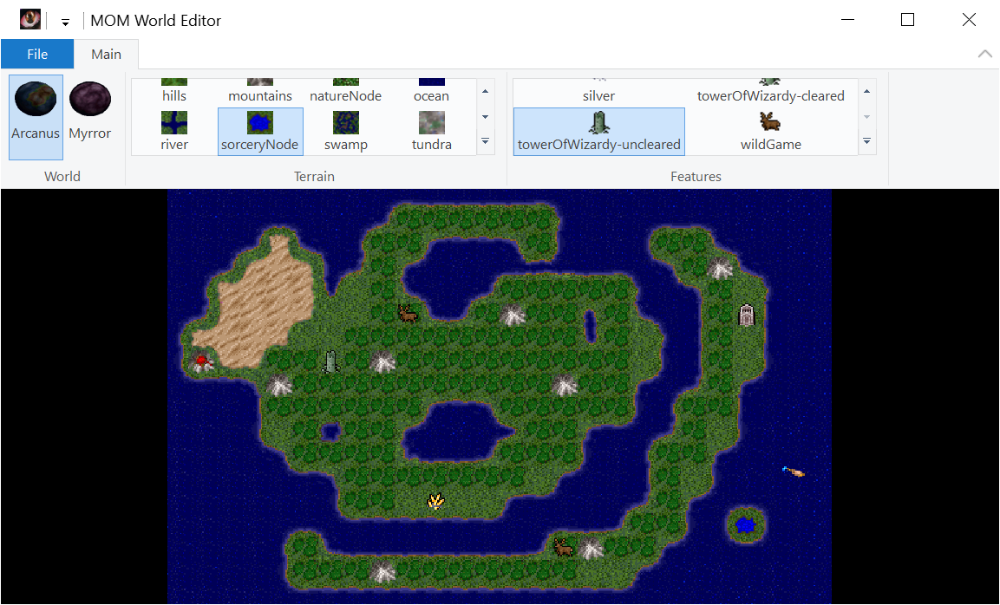
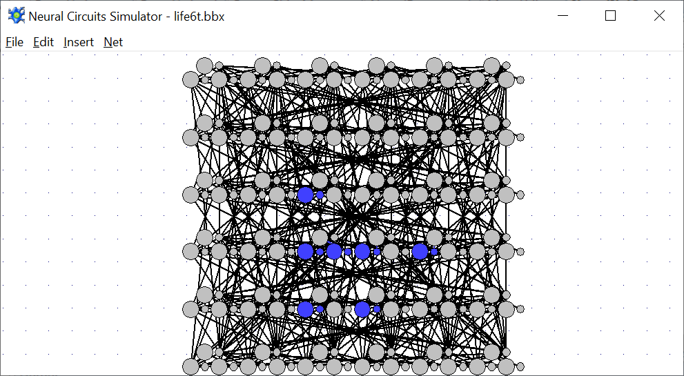
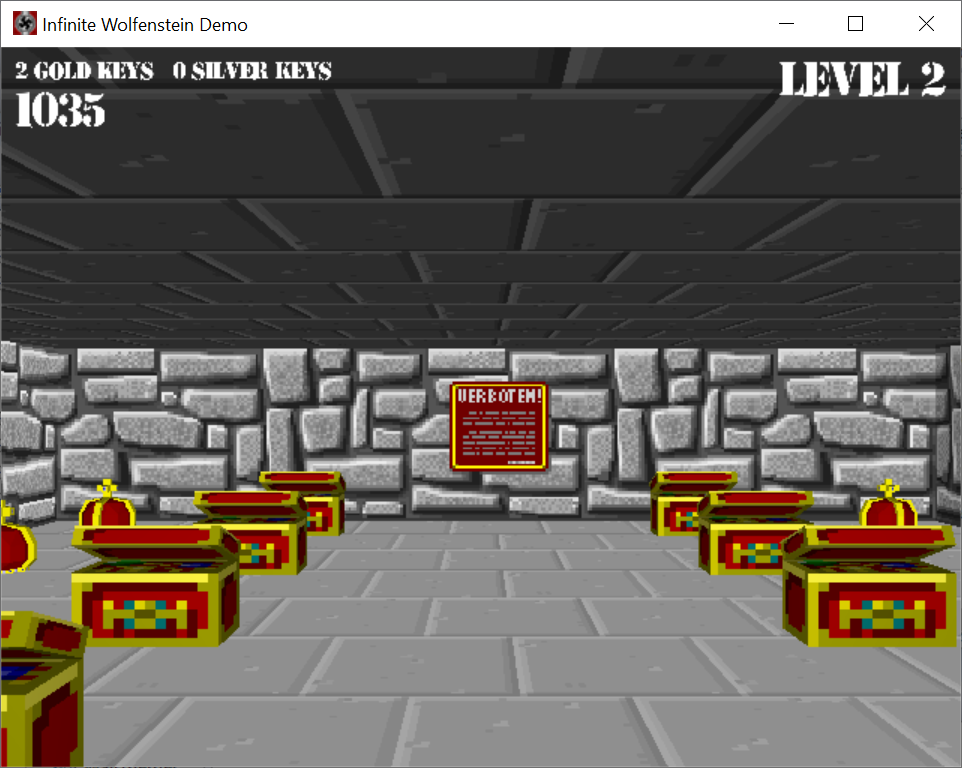
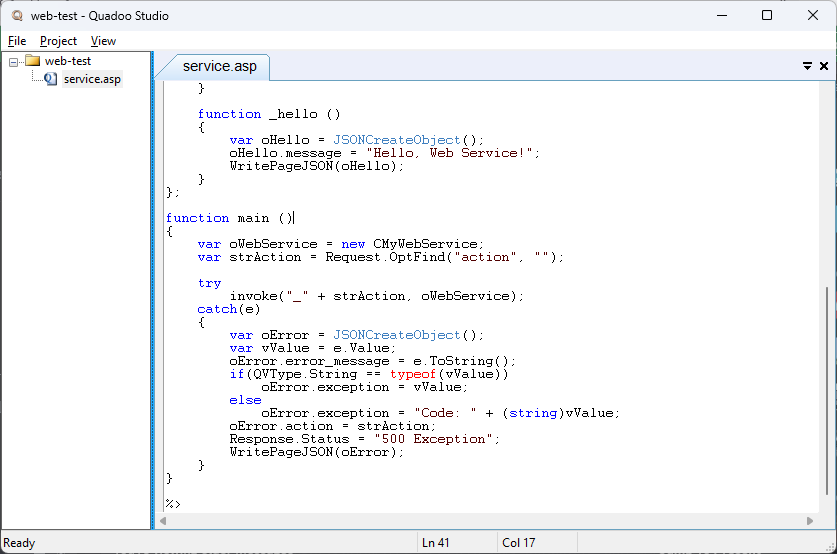
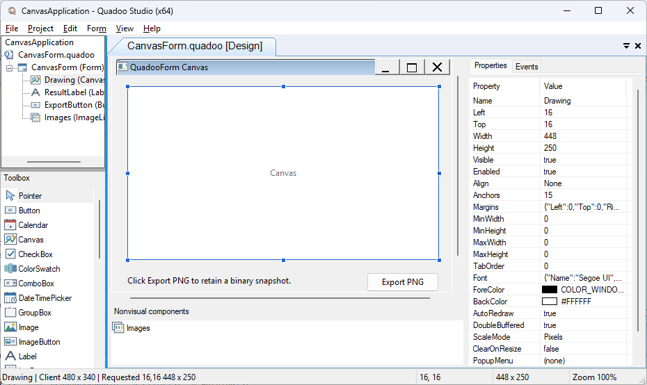
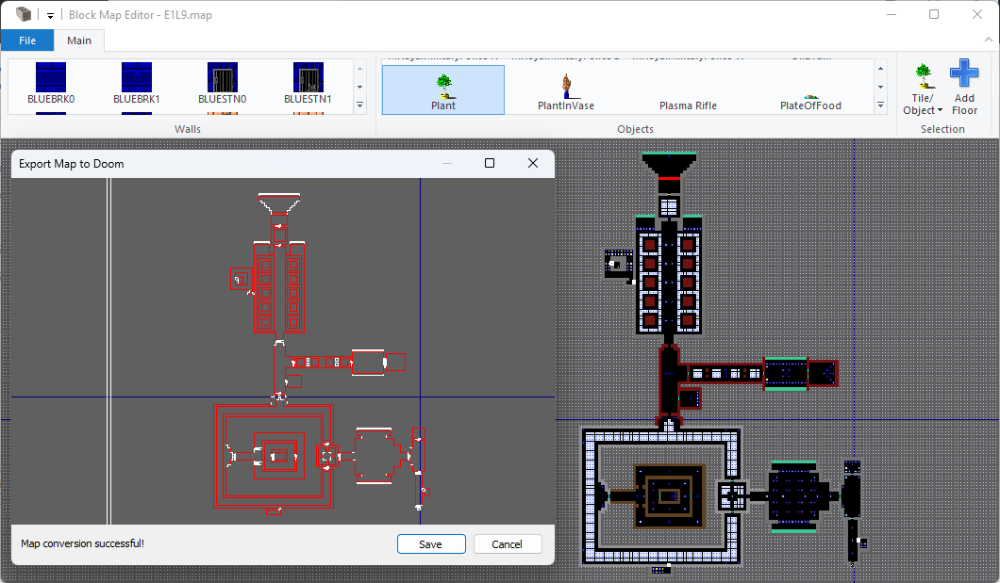

# Mirror from Simbey's SVN Repository
## Inside this GitHub repository, you will find:
* [Master of Magic Demo Projects](samples/MOMPrototypes)
* [Neural Circuits Simulator](desktop/NeuralCircuits)
* [Infinite Wolfenstein Demo](desktop/InfiniteWolfenstein)
* [Quadoo Studio](desktop/QuadooStudio)
* [PyQuadoo](tools/PyQuadoo)
* [Some of Simbey's common C++ library code and templates](shared/library)
## Screenshots:
### Master of Magic Combat Demo

### Master of Magic World Editor (Overland Rendering) Demo

### Neural Circuits Desktop Application

### Infinite Wolfenstein Desktop Demo

### Quadoo Studio ###

### Quadoo Studio with Forms Integration ###

### Block Map Editor ###

## Building Quadoo Studio

Open `desktop/QuadooStudio/QuadooStudio.sln` in Visual Studio 2008 and select Debug or Release with Win32 or x64. Build the solution, then launch `target/<configuration>/QuadooStudio.exe` (or `target/<configuration>/x64/QuadooStudio.exe`). The solution builds CodeEdit, QuadooForm, and the shared and standalone form designers against the published SimbeyCore, JSON, and QuadooScript libraries included in this mirror.

The standalone designer solution is `platform/QuadooForm/QuadooForm.sln`. Test solutions, fixtures, and command-line runners are documented in [tests/README.md](tests/README.md).

Build outputs for projects whose sources are included here are ignored, including copies placed in `bin`. Build those projects locally. Published binaries and libraries are retained for components whose implementation projects are absent from this mirror, along with required third-party dependencies and tools.
